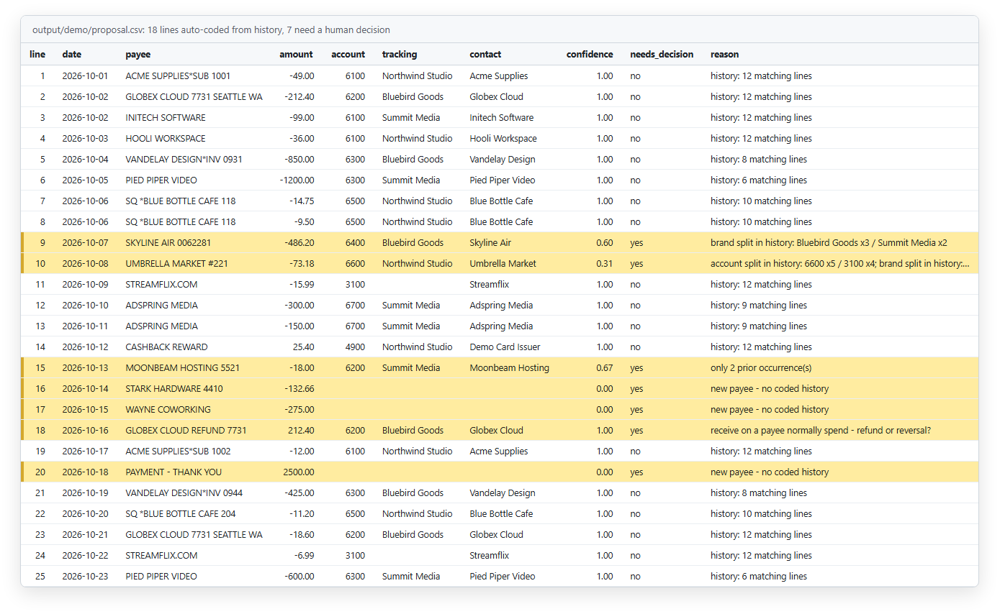
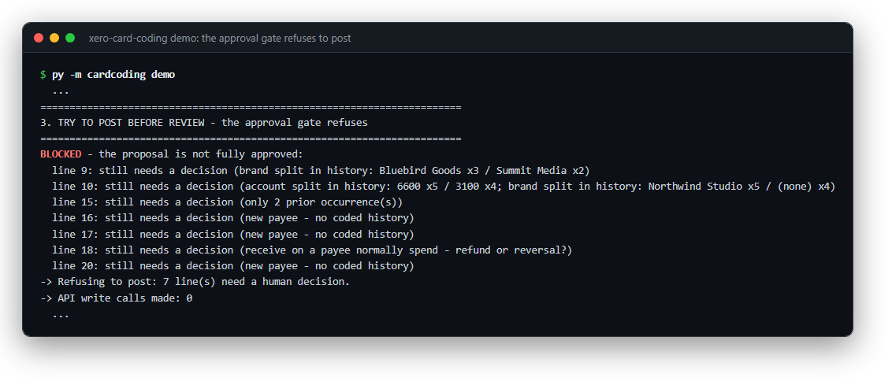
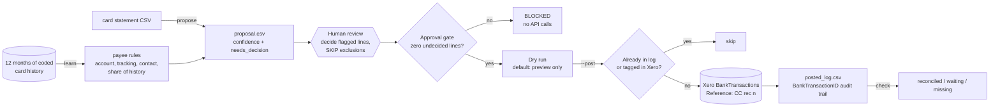
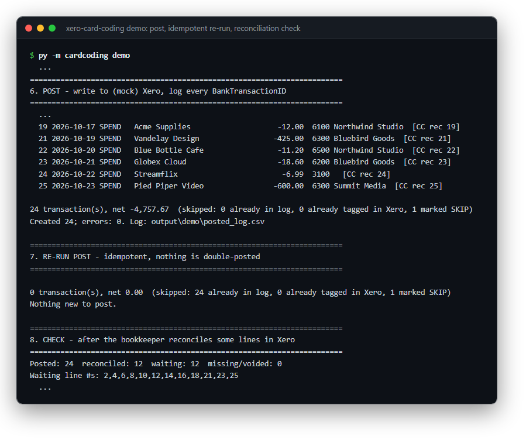

# xero-card-coding

**Code a month of credit-card spend in Xero from your own GL history, with a human approving every line before anything posts.**


*The proposal for a synthetic statement. The 7 highlighted lines (highlighting added for this screenshot) are split history, thin history, new payees or a refund, so they wait for a person.*

## The problem

Credit-card coding is the most repetitive part of a small-business close. Every month the same subscriptions, contractors and travel charges need an expense account, a tracking option (which brand or company bears the cost) and a contact. And every month someone codes them by hand in the bank reconciliation screen.

Automation that guesses wrong is worse than doing it by hand. A miscoded line can sit in the P&L for months before anyone notices, and you have to trace it back before you can fix it.

So I went for the middle ground. The tool learns the coding from what the books already say and codes the lines it's sure about. Anything it isn't sure about gets flagged, and nothing gets written to the ledger until a human has signed off on every line.

> **A human approves every write.** I run the production version of this on my own business books. It has posted ~168 transactions to a live Xero org, across several brands under one company card.

## What it does

- **Learns rules from coded history.** Pulls 12 months of card-account BankTransactions and builds payee-to-coding rules: account code, tracking option and the existing contact name, each with how consistently it was coded that way.
- **Proposes a coding for the new statement.** Every line gets an account, tracking option, contact, a confidence score and a `needs_decision` flag, written to a CSV you review in Excel.
- **Flags anything uncertain instead of guessing:** new payees, payees whose history is split across accounts or brands, payees with only one or two prior sightings, and credits on payees that are normally charges (refunds and reversals).
- **Posts approved lines** to Xero as spend/receive-money BankTransactions on the card account, unreconciled, so the bookkeeper still matches them to the bank feed.
- **Checks status:** reconciled vs. waiting vs. missing (voided), using paginated queries on the posting reference.
- **Includes a Xero connector** (`cardcoding.xero_api`) with OAuth2 authorization-code flow, granular scopes and automatic token refresh, plus a small `auth / whoami / get / post / put` CLI.

## Controls

| Control | How it works |
|---|---|
| **Approval gate** | `post --post` refuses to run while *any* line in the proposal has `needs_decision` other than `no`, or a decided line is missing its account, contact or tracking option. The check runs before any API call. |
| **Dry run by default** | `post` without `--post` prints exactly what would be created (type, contact, amount, account, tracking, reference) and makes no API calls at all. It doesn't even need credentials. |
| **Idempotency** | Lines already in the posted log are skipped. Before writing, it also queries Xero for transactions already tagged with the same reference, so a lost or deleted log still can't cause a double post. |
| **Traceability** | Every transaction carries the reference `CC rec <line>`, tying it to the statement line, and every `BankTransactionID` is appended to `posted_log.csv` with timestamp, coding and status. A batch can be found, reviewed or voided later. |
| **Partial failures retry cleanly** | Posts use `summarizeErrors=false`. Lines Xero rejects (bad account code, unknown tracking option) are reported and *not* logged, so the next run retries only those. |
| **Contact reuse** | Contacts come from the names already used in history, so the tool doesn't create duplicate contacts for each bank-text variation. |
| **Explicit exclusions** | Setting a line's account to `SKIP` keeps it out of posting (e.g. a card payment already recorded as a transfer), and the summary counts it. |
| **No secrets in code** | Credentials and the card's AccountID come from environment variables only. Tokens are stored in a gitignored file, and the rotated refresh token is saved after every refresh. |
| **Least-privilege scopes** | The OAuth request asks for only `accounting.settings`, `accounting.contacts` and `accounting.banktransactions` (plus `offline_access`). |


*The approval gate: with 7 lines undecided, `post --post` refuses before any API call.*

## Architecture



A line is auto-coded only when `account share x tracking share x support >= 0.8` and the direction (charge vs. credit) matches history. *Support* is `min(1, sightings / 3)`, so a payee seen once or twice still goes to a human.

## Quickstart

Demo mode is fully offline. It runs the whole loop on synthetic fixtures against an in-memory mock of the Xero API: learn, propose, a post attempt that the gate blocks, the reviewer's decisions, dry run, post, an idempotent re-run, then a reconciliation check.

Requires Python 3.10+.

Windows (PowerShell):

```powershell
git clone https://github.com/markvalderrama001-svg/xero-card-coding.git
cd xero-card-coding
py -m venv .venv
.venv\Scripts\python -m pip install -r requirements.txt
.venv\Scripts\python -m cardcoding --demo
.venv\Scripts\python -m pytest -q
```

<details>
<summary>macOS / Linux (bash)</summary>

```bash
git clone https://github.com/markvalderrama001-svg/xero-card-coding.git
cd xero-card-coding
python3 -m venv .venv
.venv/bin/python -m pip install -r requirements.txt
.venv/bin/python -m cardcoding --demo
.venv/bin/python -m pytest -q
```

</details>

Abridged demo output:

```
2. PROPOSE - code this month's statement; flag anything uncertain
Proposed 25 lines -> output/demo/proposal.csv
  auto-coded from history: 18
  needs a human decision:  7
    line   9  SKYLINE AIR 0062281      -486.20  guess=6400 Bluebird Goods  (brand split in history: Bluebird Goods x3 / Summit Media x2)
    line  10  UMBRELLA MARKET #221      -73.18  guess=6600 Northwind Studio  (account split in history: 6600 x5 / 3100 x4; ...)
    line  16  STARK HARDWARE 4410      -132.66  guess=-   (new payee - no coded history)
    line  18  GLOBEX CLOUD REFUND 7731  212.40  guess=6200 Bluebird Goods  (receive on a payee normally spend - refund or reversal?)
    ...
3. TRY TO POST BEFORE REVIEW - the approval gate refuses
-> Refusing to post: 7 line(s) need a human decision.
-> API write calls made: 0
...
6. POST - write to (mock) Xero, log every BankTransactionID
Created 24; errors: 0. Log: output/demo/posted_log.csv
7. RE-RUN POST - idempotent, nothing is double-posted
0 transaction(s), net 0.00  (skipped: 24 already in log, 0 already tagged in Xero, 1 marked SKIP)
8. CHECK - after the bookkeeper reconciles some lines in Xero
Posted: 24  reconciled: 12  waiting: 12  missing/voided: 0
```


*After the reviewer decides the flagged lines: 24 lines post with `CC rec` references, the re-run skips all 24, and the check reports reconciliation status.*

Each step also runs on its own with `--demo`: `learn --demo`, `propose --demo`, `post --demo`, `post --demo --post`, `check --demo`.

## Using it on a real Xero org

1. Create a Web app at developer.xero.com with redirect URI `http://localhost:8765/callback`.
2. Copy `.env.example` to `.env` and fill it in (it is gitignored), or set the same variables in your shell.
3. Connect once: `py -m cardcoding.xero_api auth`, then confirm with `py -m cardcoding.xero_api whoami`.
4. Monthly loop:

```powershell
py -m cardcoding pull-history      # 12 months of card-account BankTransactions -> data/history.json
py -m cardcoding learn             # -> output/rules.json
# save the statement as data/statement.csv with columns: line,date,payee,amount (charges negative)
py -m cardcoding propose           # -> output/proposal.csv
# review in Excel: fix every needs_decision=yes line, set it to no; SKIP anything that must not post
py -m cardcoding post              # dry run: read the preview
py -m cardcoding post --post       # write to Xero
py -m cardcoding check             # after reconciling in Xero
```

<details>
<summary>macOS / Linux (bash)</summary>

```bash
python3 -m cardcoding pull-history      # 12 months of card-account BankTransactions -> data/history.json
python3 -m cardcoding learn             # -> output/rules.json
# save the statement as data/statement.csv with columns: line,date,payee,amount (charges negative)
python3 -m cardcoding propose           # -> output/proposal.csv
# review in Excel: fix every needs_decision=yes line, set it to no; SKIP anything that must not post
python3 -m cardcoding post              # dry run: read the preview
python3 -m cardcoding post --post       # write to Xero
python3 -m cardcoding check             # after reconciling in Xero
```

</details>

Whatever you decide this month gets posted with that coding, so it shows up in next month's history and gets auto-coded from then on. The more months you run it, the fewer lines come back flagged.

## Project structure

```
cardcoding/
  xero_api.py     OAuth2 auth-code flow, token refresh with rotation, API calls, raw CLI
  learn.py        history -> payee rules (majority coding + share + support)
  propose.py      statement -> proposal.csv with confidence and needs_decision; apply decisions
  post.py         approval gate, dry run, idempotent posting, reference tagging, audit log
  check.py        paginated reconciled / waiting / missing report
  mock_xero.py    in-memory Xero stand-in used by --demo and tests
  config.py       env-driven settings
  __main__.py     CLI and the scripted demo
fixtures/
  history_sample.json   synthetic 12-month coded card history (121 transactions)
  statement_sample.csv  synthetic 25-line statement, 7 lines need a decision
  demo_decisions.csv    the reviewer's decisions used by the demo
tests/            pytest suite, fully offline (all HTTP mocked)
docs/             README screenshots
.env.example      Xero app credentials and card AccountID placeholders
pyproject.toml
requirements.txt
```

All companies, vendors, brands, account codes, amounts and IDs in this repo are synthetic.

Independent project. Not affiliated with or endorsed by Xero; names are used only to describe what the code connects to.

---

**About.** Mark Valderrama, CPA · Finance Engineer. I run the production version in my own businesses. [LinkedIn](https://www.linkedin.com/in/markvalderrama/)

MIT License, see [LICENSE](LICENSE).
